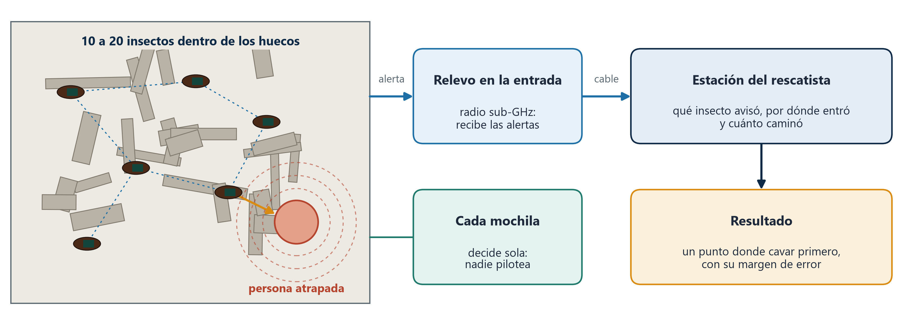
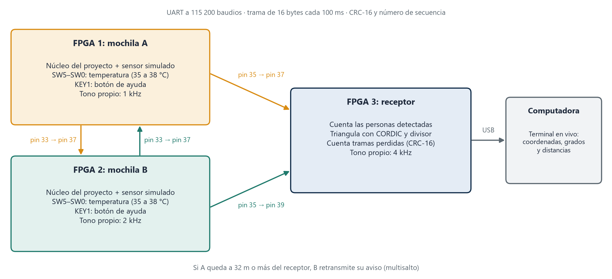
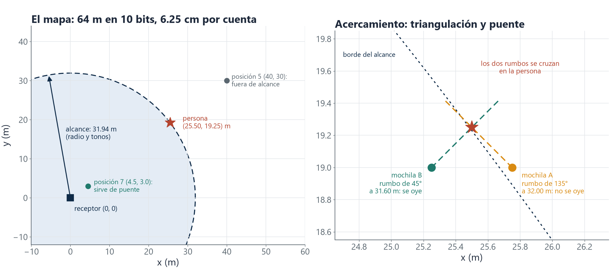
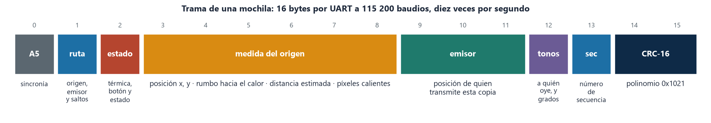
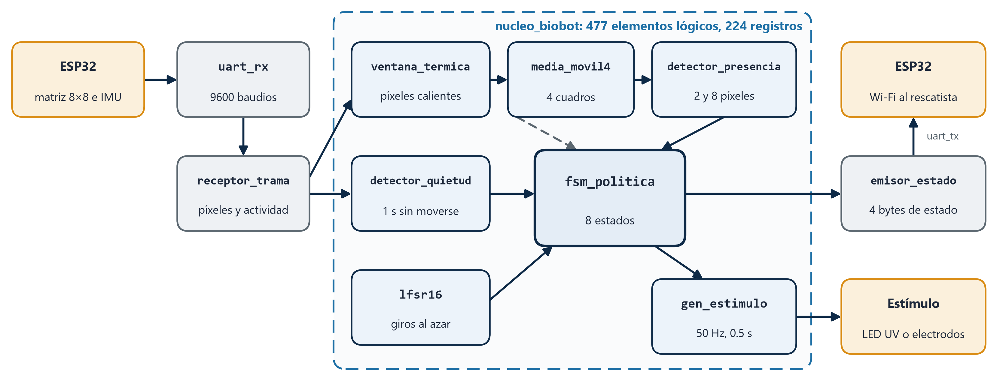
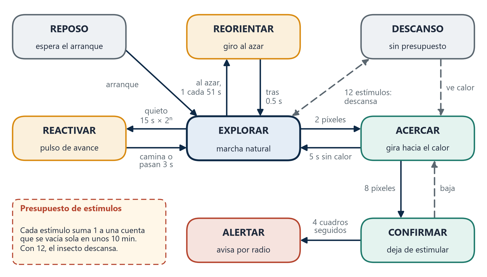
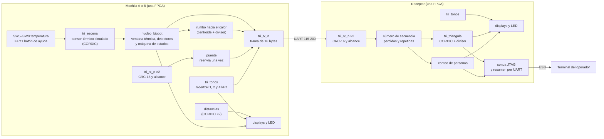
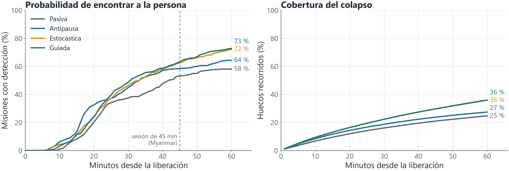

# BioBot-Rescue

**Mochila electrónica para que una cucaracha de Madagascar busque personas atrapadas después de un sismo.**
Proyecto final de Sistemas Embebidos (O26-LRT3032-2), Universidad de las Américas Puebla, otoño de 2026.

| | |
|---|---|
| **Equipo** | Roberto Orozco Ramírez · Adam Del Pozo Ontiveros · Enrique Bernal Martín Prieto |
| **Profesor** | Dr. Gerardo Ulises Díaz Arango |
| **Tarjeta** | Terasic DE10-Lite, Intel MAX 10 `10M50DAF484C7G` |
| **Lenguaje y herramientas** | Verilog-2005 · Quartus Prime Lite 24.1 · Icarus Verilog 12 · Active-HDL · Python 3.12 |



## Resumen

Tras un sismo, la probabilidad de sacar con vida a una persona atrapada cae rápido con las horas, y los
huecos entre los escombros son demasiado estrechos para un perro o un robot. Una cucaracha silbadora de
Madagascar (*Gromphadorhina portentosa*) sí cabe, y puede cargar entre 2 y 3 g.

BioBot-Rescue es el circuito digital de esa carga: una mochila que **detecta el calor de una persona,
decide sola cuándo estimular al insecto y avisa por radio**. Todo el procesamiento está en hardware
(Verilog sobre FPGA): no hay procesador ni programa a bordo. Este repositorio contiene

- el **núcleo de la mochila**, verificado registro por registro contra un modelo de referencia;
- una **red de tres FPGA** que lo pone a prueba: dos mochilas que detectan, se localizan por tonos y se
  retransmiten los avisos, y el receptor del operador, que triangula la posición de la persona;
- la **simulación de misión** en Python con la que se eligieron los parámetros, la investigación con sus
  fuentes y el reporte.

## La demostración: red de tres FPGA



Dos DE10-Lite son las mochilas de dos cucarachas (A y B). La tercera es el receptor del operador, en la
entrada del derrumbe. La computadora solo muestra lo que el receptor ya calculó.

| Qué hace | Cómo |
|---|---|
| **Detecta a una persona por temperatura** | El sensor térmico (matriz de 8×8) se simula con los interruptores SW5–SW0, en grados. El núcleo detecta entre **35 y 38 °C** y descarta lo más frío y lo más caliente (un objeto a 47 °C no cuenta) |
| **Detección redundante** | KEY1 es el botón de ayuda que va sobre la cucaracha: si alguien lo aprieta, hay una persona viva |
| **Cuenta las personas detectadas** | Las tres tarjetas muestran `Pd` y el número (0, 1 o 2). Si la temperatura sale del intervalo, el conteo baja en menos de un segundo |
| **Sabe a quién oye** | Cada nodo emite un tono propio (A 1 kHz, B 2 kHz, receptor 4 kHz) y detecta los otros dos con filtros de Goertzel. Los dos últimos displays muestran las letras de los nodos que oye |
| **Mide distancias** | Cinco LED para los metros a cada vecino, en binario. Si no se oye a un nodo, sus LED se apagan |
| **Tiene alcance** | A menos de 32 m se oye; **a 32 m o más, no** |
| **Retransmite (puente)** | Si una mochila queda fuera del alcance del receptor, la otra reenvía su aviso |
| **Triangula** | El receptor cruza los rumbos que miden las dos mochilas y estima dónde está la persona |
| **Informa al operador** | Una terminal en la computadora muestra todo con decimales, en vivo, y permite mover las cucarachas |

### Qué se ve en cada tarjeta

| Indicador | En una mochila | En el receptor |
|---|---|---|
| HEX5 | Quién es: `A` o `b` | `r` |
| HEX4–HEX3 | `Pd` (personas detectadas) | `Pd` |
| HEX2 | Cuántas: 0, 1 o 2 | Lo mismo |
| HEX1 | La letra de la otra mochila, si oye su tono | `A`, si oye el tono de A |
| HEX0 | `r`, si oye el tono del receptor | `b`, si oye el tono de B |
| LEDR9–5 | Metros a la otra mochila | Metros a la mochila A |
| LEDR4–0 | Metros al receptor | Metros a la mochila B |

La guía paso a paso, con el cableado, los controles y el guion de la demostración, está en
[GUIA_LABORATORIO.md](GUIA_LABORATORIO.md).

### El mapa y el alcance



Las posiciones van en 10 bits sobre un mapa de 0 a 64 m: **una cuenta vale 6.25 cm**. El receptor está en
(0, 0) y la persona en (25.50, 19.25) m, a 31.95 m: justo en el borde del alcance, que es de 511 cuentas
(31.94 m) para el radio y para los tonos. Por eso, de dos mochilas que están junto a la persona, una puede
quedar dentro del alcance y la otra fuera, y entonces la primera hace de puente.

### El protocolo de enlace



UART 8N1 a 115 200 baudios. Cada mochila transmite una trama de 16 bytes diez veces por segundo:

| Byte | Contenido |
|---|---|
| 0 | `0xA5`, sincronía |
| 1 | Origen (quién midió), emisor (quién transmite esta copia) y número de saltos |
| 2 | Detección térmica, botón, mancha a la vista, rumbo válido y estado del núcleo |
| 3–8 | Posición del origen, rumbo hacia el calor, distancia estimada y píxeles calientes |
| 9–11 | Posición del emisor |
| 12 | A quién oye por tonos y la temperatura del sensor |
| 13 | Número de secuencia |
| 14–15 | CRC-16/CCITT de los bytes 1 a 13 (polinomio `0x1021`, valor inicial `0xFFFF`) |

Quien recibe descarta la trama si el CRC no coincide, si se interrumpe más de 2 ms o si el emisor está a
32 m o más. Una mochila reenvía una sola vez las tramas de la otra (multisalto). Con el número de secuencia
el receptor cuenta las tramas perdidas y reconoce la que le llega repetida por dos caminos. Si en un
segundo no llega nada de una mochila, la da por perdida.

### Localización por tonos

Cada nodo muestrea su micrófono a 16 kHz y, cada 64 muestras (4 ms), tres filtros de Goertzel miden la
potencia en 1, 2 y 4 kHz. El filtro es un IIR de segundo orden:

$$s[n] = x[n] + c\,s[n-1] - s[n-2], \qquad c = 2\cos\frac{2\pi k}{64}$$

$$P = s[N-1]^2 + s[N-2]^2 - c\,s[N-1]\,s[N-2]$$

Las tres frecuencias caen exactamente en las líneas 4, 8 y 16 de una transformada de 64 puntos, así que un
tono no se cuela en el filtro de otro. Un tono se da por oído si su potencia pasa del umbral en dos bloques
seguidos. En la demostración no hay bocinas ni micrófonos: el canal acústico va simulado dentro de la FPGA
(el tono de un nodo «llega» solo si ese nodo está a menos de 32 m) y los filtros trabajan sobre esa señal,
con ruido añadido. Con un micrófono real, esa señal se sustituye por las muestras del convertidor.

### Triangulación

Cada mochila mide el rumbo hacia el calor: el centroide de las columnas calientes de la matriz, más el
rumbo del insecto. El receptor cruza las dos rectas:

$$P = A + t\,\hat{u}_A, \qquad t = \frac{(B - A)\times\hat{u}_B}{\hat{u}_A\times\hat{u}_B}$$

Los senos y cosenos salen de un **CORDIC** secuencial de 16 iteraciones y el cociente de un divisor con
restauración; la trigonometría no usa tablas de seno ni funciones de biblioteca. Si los rumbos son casi
paralelos (menos de 10° entre sí), si las rectas se cruzan detrás de una mochila o si el cruce queda a más
de 3 m, el receptor lo indica y usa la aproximación de cada mochila por separado.

## Arquitectura

### El núcleo de la mochila



`nucleo_biobot` recibe los 64 píxeles de la matriz térmica y la actividad del insecto. Cuenta los píxeles
dentro de la ventana de temperatura de la piel, los filtra con una media móvil y decide si hay presencia;
una máquina de ocho estados elige qué hacer en cada momento. El estímulo sale como un tren de pulsos de 50 Hz.



### Dentro de cada FPGA de la red



### Qué hace la FPGA y qué hace la computadora

| Función | Dónde corre |
|---|---|
| Detección térmica, filtrado, decisión y estímulo | FPGA (mochila) |
| Rumbo hacia el calor y distancias | FPGA (mochila) |
| Tramas, CRC-16, número de secuencia, alcance y puente | FPGA (las tres) |
| Generación y detección de tonos | FPGA (las tres) |
| Conteo de personas y triangulación | FPGA (receptor) |
| Displays y LED | FPGA (las tres) |
| Mostrar los datos y mandar órdenes de prueba | Computadora |

La computadora no calcula nada del sistema: lee por el cable USB-Blaster lo que el receptor ya tiene en
sus registros, lo convierte a metros y grados y lo escribe en pantalla. Si se desconecta, las tres
tarjetas siguen funcionando igual.

Esto es lo que ve el operador cuando las dos mochilas detectan a la persona (salida de la terminal con las
tres tarjetas simuladas, [sim/terminal_simulada.txt](sim/terminal_simulada.txt)):

```
=============== BioBot-Rescue: vista del operador (receptor) ===============
PERSONAS DETECTADAS: 2
Persona estimada en (25.56, 19.25) m  ->  TRIANGULADA (dos rumbos)

Mochila A   [radio: por el puente B]   posicion (25.75, 19.00) m, a 32.00 m del receptor
            termica SI, 36 C | boton no | ALERTAR | pixeles calientes 14 | rumbo 133.6 grados
            tonos: oye a B SI, oye al receptor no
Mochila B   [radio: directo]   posicion (25.25, 19.00) m, a 31.56 m del receptor
            termica SI, 37 C | boton no | ALERTAR | pixeles calientes 12 | rumbo 43.2 grados
            tonos: oye a A SI, oye al receptor SI

Receptor    tonos: oye a A (1 kHz) no [potencia 43], oye a B (2 kHz) SI [potencia 27600]
            distancia entre A y B 0.50 m | LED 0000011111 (metros a A | metros a B)
Enlace      tramas perdidas: de A 0, de B 0 | descartadas por CRC 0
```

La persona está en (25.50, 19.25) m: el error es de una cuenta (6.25 cm). Las distancias se truncan a
cuentas, por eso B aparece a 31.56 m y no a 31.60 m.

## Resultados

### Verificación por simulación

| Banco | Qué comprueba | Resultado |
|---|---|---|
| `tb_nucleo` | El núcleo contra el modelo de referencia en Python, registro por registro | 11 424 de 11 424 cuadros idénticos; los ocho estados visitados |
| `tb_gen_estimulo` | El tren de estímulo | 3 de 3 trenes: 25 periodos de 20.000 ms |
| `tb_top` | El núcleo con su enlace serie | 500 de 500 respuestas por UART |
| `tb_demo`, `tb_dos_tarjetas` | Lazo cerrado con un insecto simulado, en una y en dos tarjetas | Con persona alerta en el cuadro 558 (56 s); con un objeto caliente, sin persona o con un insecto que no responde, no alerta |
| `tb_cordic` | CORDIC en rotación y vectorización, y el divisor | 248 de 248 casos; error máximo de 0.008° en el ángulo y 0.013 % en la magnitud |
| `tb_tonos` | Los tres filtros de Goertzel con ruido | 8 de 8; un tono presente mide entre 27 000 y 33 000 unidades y el silencio menos de 50 |
| `tb_tri` | Las tres FPGA cableadas como en el laboratorio, nueve escenarios | 9 de 9 escenarios correctos |
| `tb_sonda` y `prueba_terminal.tcl` | La terminal real del operador contra las tres tarjetas simuladas con sus módulos superiores: cada orden, los bits que llegan a la FPGA y lo que la terminal muestra al leerla | 47 de 47 comprobaciones en 12 pasos |

Los nueve escenarios de `tb_tri`: triangulación con puente, objeto caliente y bordes del intervalo, una
sola mochila, rumbos opuestos, botón, sin alcance, seguimiento del sensor, ruido en la línea y umbral de
31 y 32 m.

| Medida en `tb_tri` | Valor |
|---|---|
| Error de triangulación, con la persona a 31.95 m del receptor | 6.2 cm (una cuenta) |
| Tiempo desde que los sensores ven a la persona hasta que el receptor da su posición | 1.10 s |
| Rumbo medido por cada mochila | A 133.6° (real 135.0°), B 43.5° (real 45.0°) |
| Intervalo de detección | 34 °C no, 35 °C sí, 38 °C sí, 39 °C no; 47 °C no cuenta |
| Seguimiento del sensor | El conteo pasa de 2 a 1 y a 0 al salir del intervalo, y vuelve a subir al regresar |
| Umbral de alcance | A 31.00 m se oye (potencia del tono 25 840); a 32.00 m no (potencia 0); a 31.88 m sí |
| Potencia medida de un tono | Presente, cerca de 28 000; ausente, 104 o menos (umbral: 4 000) |
| Ruido en la línea durante 3 s | 14 tramas descartadas por CRC, 15 perdidas contadas por número de secuencia, ningún dato equivocado; al terminar, triangula con el mismo error |

### Síntesis

Quartus Prime Lite 24.1, MAX 10 `10M50DAF484C7G` (49 760 elementos lógicos), reloj de 50 MHz.

| Variante | Elementos lógicos | Registros | Multiplicadores de 9 bits | Frecuencia máxima | Holgura a 50 MHz |
|---|---|---|---|---|---|
| Mochila A | 4 812 (10 %) | 2 319 | 43 | 56.15 MHz | 2.19 ns |
| Mochila B | 4 832 (10 %) | 2 319 | 43 | 55.96 MHz | 2.13 ns |
| Receptor | 6 220 (13 %) | 2 591 | 76 | 57.16 MHz | 2.51 ns |
| Receptor con la mochila B (para hacerlo con dos tarjetas) | 8 838 (18 %) | 4 128 | 107 | 56.88 MHz | 2.42 ns |

Las cuatro cumplen el reloj de 50 MHz sin advertencias críticas; la frecuencia es la del peor caso (modelo
lento, 85 °C). `sintetizar_red.ps1` repite la síntesis y arma esta tabla a partir de los reportes.

A dónde se van los recursos:

| Bloque | Mochila A | Receptor |
|---|---|---|
| Núcleo de la mochila (`nucleo_biobot`) | 405 EL, 177 registros | — |
| Sensor térmico simulado (`tri_escena`, con su CORDIC) | 858 EL | — |
| Triangulación (`tri_triangula`: CORDIC y divisor de 44 bits) | — | 1 514 EL, 631 registros |
| Distancias (CORDIC en vectorización) | 2 × ~500 EL | 3 × ~490 EL |
| Detector de tonos (`tri_tonos`, tres filtros de Goertzel) | 358 EL, 225 registros | 412 EL, 225 registros |
| Recepción de tramas con CRC-16 (`tri_rx_n` × 2) | 740 EL | 696 EL |
| Transmisión de tramas (`tri_tx_n`) | 209 EL | 365 EL |
| Sonda JTAG para la computadora | 322 EL | 412 EL |

EL = elementos lógicos. El núcleo de la mochila, que es lo que iría en el circuito integrado, es la parte
más pequeña: sintetizado solo ocupa 477 elementos lógicos y 224 registros (722 y 372 con su enlace serie).
Lo demás es la red, la localización y el sensor simulado de la demostración.

### En las tarjetas

| Fecha | Montaje | Resultado |
|---|---|---|
| 11-11-2026 | Una DE10-Lite, núcleo con insecto simulado | Con persona alerta a los 7.4 s en modo rápido; en los otros tres escenarios no alerta |
| 11-11-2026 | Dos DE10-Lite unidas por UART, en tiempo real | Alerta a los 55.1 s (la simulación da 55.6 s); sin alerta con el objeto a 47.5 °C, sin persona y con el insecto que no responde |
| 18-11-2026 | Tres DE10-Lite, red de detección y triangulación | Seis escenarios correctos; error de triangulación de 2.8 cm; el aviso de A llega por el puente |
| 18-11-2026 | Sensor simulado en la tarjeta | Detecta con 35, 36 y 38 °C; no con 34, 39, 47 ni 22 °C; al salir del intervalo se apaga en 0.77 s |

La prueba del 18 de noviembre con tres tarjetas se hizo con la versión anterior del enlace (mapa de 20 m,
suma de verificación simple y sin tonos). La versión de este repositorio, con CRC-16, número de secuencia,
tonos y mapa de 64 m, está simulada y sintetizada; la prueba en las tarjetas se repite con
`sim/prueba_tri.tcl`.

### Simulación de misión



Con diez insectos y 320 misiones por caso, la detección en una hora sube de 58 % sin estímulos a 73 % con
la política guiada (margen de ±5 puntos). El resultado depende del derrumbe: de ocho mapas, en tres guiar
cambia el resultado, en cuatro da igual y en uno empeora (de 98 a 52 %). El análisis completo, con
sensibilidad, habituación y el regreso de los insectos, está en el reporte.

## Cómo reproducirlo

Requisitos: Icarus Verilog 12 en `C:\iverilog\bin`, Quartus Prime Lite 24.1 en `C:\intelFPGA_lite\24.1std`,
Python 3.12 con `matplotlib` y PowerShell 7.

```powershell
# Bancos de prueba (ocho bancos, unos minutos)
pwsh -File sim\simular.ps1

# Además, las tres FPGA con sus nueve escenarios (cerca de una hora)
pwsh -File sim\simular.ps1 -Completa

# La terminal del operador contra las tres tarjetas simuladas, sin hardware (cerca de una hora)
pwsh -File sim\probar_terminal.ps1

# Síntesis de las cuatro variantes de la red, con resumen de recursos y tiempos
pwsh -File sintetizar_red.ps1
```

En las tarjetas (tres DE10-Lite por USB y seis cables en JP1, como indica la guía):

```powershell
.\CARGAR_RED.cmd      # carga las tres tarjetas y verifica los cuatro enlaces
.\DEMO.cmd            # abre el monitor en vivo y la ventana de órdenes
& 'C:\intelFPGA_lite\24.1std\quartus\bin64\quartus_stp.exe' -t sim\prueba_tri.tcl   # prueba automática
```

Para ver las formas de onda en Active-HDL, desde su consola:
`do ".../activehdl/crear_workspace.do"`, `do ".../activehdl/compilar.do"` y después `simular_red.do`,
`simular_tonos.do` o `simular_cordic.do`.

La simulación de misión y el reporte:

```powershell
cd modelo; python experimentos.py     # lote de Monte Carlo (cerca de dos horas)
pwsh -File compilar.ps1               # figuras y PDF
```

## Estructura del repositorio

```
hdl/                    Verilog sintetizable
  nucleo_biobot.v         núcleo de la mochila: ventana_termica, detectores, fsm_politica, gen_estimulo
  cordic.v                CORDIC secuencial y divisor con restauración
  tonos.v                 generador de tono y tres filtros de Goertzel
  tri_red.v               red de tres FPGA: tramas con CRC-16, escena térmica, mochila, triangulación y receptor
  tri_top.v               módulos superiores para la DE10-Lite, con sonda JTAG
  uart_rx.v, uart_tx.v    UART de la práctica 4
  ...                     montajes anteriores: una tarjeta, dos tarjetas y red de botón y puente
sim/                    bancos de prueba (tb_*.v), simular.ps1 y pruebas en tarjeta (prueba_*.tcl)
pc/                     terminal del operador (Tcl sobre quartus_stp)
quartus_tri_*/          proyectos de Quartus de la red: mochila A, mochila B, receptor y receptor con B
quartus*/               proyectos de los montajes anteriores
activehdl/              espacio de trabajo y macros de Active-HDL
modelo/                 simulación de misión, modelo de referencia del núcleo y figuras
esp32/                  programa del ESP32 para leer una matriz AMG8833 real
investigacion/          notas de investigación con cada dato, su fuente y su nivel de confianza
latex/                  fuentes del reporte y figuras
presentacion/           fuentes de la presentación
GUIA_LABORATORIO.md     cómo montar y probar cada demostración
```

Los `.sof` de cada proyecto están en su carpeta `output_files/`, listos para cargar.

## Límites y trabajo futuro

Lo que **no** está hecho:

- **El sensor y los tonos están simulados dentro de la FPGA.** No se conectó una matriz térmica ni un
  micrófono. El programa del ESP32 que lee una AMG8833 real compila, pero no se probó en hardware.
- **No se hizo ninguna prueba con insectos.** La respuesta al estímulo y la marcha vienen de la literatura.
- **El radio es un cable.** El alcance de 32 m es un parámetro; la atenuación real entre escombros está
  discutida en el reporte, no medida.
- **La posición de cada mochila se da por conocida.** En el sistema real saldría de la odometría del
  insecto y de los tonos; aquí la fijan los interruptores o la terminal.

Trabajo futuro:

- **Circuito integrado.** Llevar el núcleo a un diseño físico con OpenLane y el proceso SKY130 de
  SkyWater. La estimación por conteo de celdas da cerca de 0.014 mm²; falta correr el flujo completo.
- **Sensores reales**: matriz térmica AMG8833 o MLX90640, micrófono MEMS y sensor de CO₂, con un
  clasificador a bordo que fusione las tres señales.
- **Distancia por tonos**: medir la potencia recibida o el tiempo de llegada para estimar la distancia, y no
  solo saber a quién se oye.
- **Regreso de los insectos**: un faro infrarrojo en la entrada que la mochila siga con dos fotodiodos; la
  simulación da 91 % de recuperación si se percibe hasta 6 m.
- **Pruebas en recinto cerrado** con la colonia de la universidad, bajo la NOM-062-ZOO-1999 y la Ley General
  de Vida Silvestre.

## Documentos

- [Reporte de investigación (PDF)](Esquema_Investigacion_BioBot-Rescue.pdf), con las referencias en formato IEEE.
- [Resumen de una página (PDF)](BioBot-Rescue_en_una_pagina.pdf).
- [Guía de laboratorio](GUIA_LABORATORIO.md).
- [Notas de investigación](investigacion/): biología, estimulación, hardware, búsqueda y rescate, ética y
  normativa, parámetros de marcha, y sensores adicionales y red.

Todas las figuras son propias y se generan con los programas de `modelo/`.
